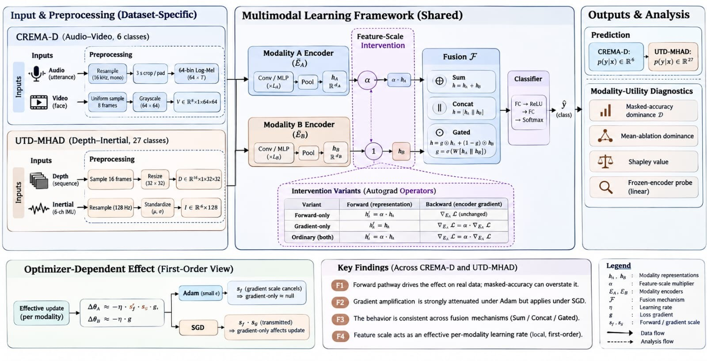

# Modality Scale Collapse

[](LICENSE)


A controlled study of what happens to a two-modality network when one modality's features
are larger than the other's, and of whether the standard way of measuring "modality
dominance" can be trusted.

When one encoder's output is multiplied by a constant α, two things change at once: the
fusion layer sees a larger signal, and that encoder receives a larger gradient. Custom
autograd operators separate the two, so each effect can be measured on its own. The study
shows that feature scale behaves like a hidden per-modality learning rate whose effect depends
on the optimizer, and that zero-masking accuracy (the usual dominance measure) can report a
large shift in modality contribution when the encoders have barely changed.

The repository contains the experiment code, every result file behind the reported numbers,
two IEEE-format manuscripts, an interactive website, and a Prediction Studio that runs the
trained models on uploaded audio, video, depth and inertial files.


*Conceptual overview from the CA manuscript. The exact layer-by-layer models are on the website's Model Architecture page.*

## Findings

**Feature scale acts as a per-modality learning rate, and the optimizer decides the pathway.**
To first order, the effective learning-rate multiplier on the scaled encoder is `s_f · s_g`
under SGD and `s_f` under Adam, where `s_f` and `s_g` are the forward and gradient gains
([derivation](docs/THEORY.md)). The experiments match this:

- Adam cancels a gradient gain: a ~100× gradient ratio becomes an update ratio of 1.00, and the
  gradient-only intervention has no effect. SGD passes it through (update ratio 95.8).
- Raising Adam's ε breaks the cancellation (update ratio 1.00, 1.02, 2.84 for ε = 1e-8, 1e-4, 1e-2).
- Under SGD, dividing the scaled encoder's learning rate by α restores the baseline exactly
  (dominance +0.003, the same as the unscaled model).

**Masked-accuracy dominance can overstate what the encoders learned.** Each setting below is
measured with the standard zero-masking dominance and with three decoupled metrics that look at
the representation itself (frozen-encoder linear probe, mean-ablation dominance, two-modality
Shapley value). Shifts are relative to the unscaled baseline, with paired Student-t 95% CIs.

| Setting | Masked dominance | Decoupled metrics |
|---|---|---|
| Synthetic, Adam, forward ×100 (10 seeds) | −0.063 ± 0.011 | probe −0.034 ± 0.006, mean-ablation −0.056 ± 0.005, Shapley −0.043 ± 0.003: real degradation, all metrics agree |
| CREMA-D, Adam, forward ×100 (5 seeds) | +0.259 ± 0.044 | mean-ablation +0.012 ± 0.027 and Shapley +0.014 ± 0.026 (not significant); probe +0.023 ± 0.017 |
| CREMA-D, SGD with gradient clipping, gradient ×100 (5 seeds) | +0.200 ± 0.050 | mean-ablation −0.001, Shapley +0.002, probe −0.001 |
| UTD-MHAD, Adam, forward ×100 on inertial (5 seeds) | 0.525 ± 0.048 toward inertial | inertial probe +0.102 ± 0.048 (about 5× smaller) |
| CREMA-D, OGM-GE rebalancing, no scaling (5 seeds) | +0.240 ± 0.042 | mean-ablation −0.023 ± 0.024 and Shapley −0.026 ± 0.030 (not significant) |

A positive control (noise added to the audio) lowers the probe and Shapley value, so the
decoupled metrics do detect real damage. On real data, zeroing a modality that the classifier
head was trained to expect at a different scale pushes the head off its training distribution:
accuracy drops because the head is confused, not because the encoder lost information.

The full account, including the negative results and pre-registered predictions that failed, is
in [docs/EXPLANATION_IN_DEPTH.md](docs/EXPLANATION_IN_DEPTH.md); every claim and its status is
in [docs/CLAIMS_LEDGER.md](docs/CLAIMS_LEDGER.md).

## Repository layout

```
analysis/        dominance, mean-ablation, Shapley, frozen-encoder probe, compensation, statistics
baselines/       OGM-GE re-implementation for the shared sum-fusion setting
backend/         FastAPI service behind the Prediction Studio
checkpoints/     the two baseline model packages used by the Studio (SHA-256 verified at load)
configs/         YAML configuration for each experiment family
data/            synthetic generator, CREMA-D and UTD-MHAD loaders and split/manifest builders
docs/            write-up, claims ledger, run log, pre-registrations, experiment reports
experiments/     one script per experiment; the forward/gradient operators are in disentangle_scale_grad.py
inference/       Studio engine: safe loading, training-identical preprocessing, probes, OOD and quality checks
interventions/   scale injection, per-modality normalization, activation-norm diagnostic
models/          encoders, fusion, heads and the synthetic, CREMA-D and UTD-MHAD models
msc/             seeding, device selection, run records with git provenance
research_paper/  LaTeX sources, figures and the compiled 6-page paper
results/         frozen outputs (CSV, JSON, figures) behind every reported number
scripts/         website data exporters, Studio checkpoint builder and calibration
tests/           pytest suites: models, synthetic data, Prediction Studio, website artifacts
website/         React + TypeScript site and Studio frontend
```

## Getting started

Requirements: Python 3.11 or newer, a CUDA build of PyTorch 2.4 or newer, and Node.js 18 or
newer for the website. The results were produced on an NVIDIA RTX 4070 Laptop GPU (8 GB) with
Python 3.13, PyTorch 2.11 and CUDA 12.8.

```bash
git clone https://github.com/lalith557/Modality-Collapse.git
cd Modality-Collapse
pip install torch --index-url https://download.pytorch.org/whl/cu128   # choose the index for your CUDA version
pip install -r requirements.txt
pip install -r requirements-studio.txt                                # Studio, media decoding, test dependencies
```

A conda environment is described in `environment.yml`. Experiments refuse to fall back to the
CPU unless `device.allow_cpu` is set in the config.

### Datasets

| Dataset | Use | Location |
|---|---|---|
| Synthetic (8 classes, two 32-d modalities, equal information by construction) | mechanism tests | generated by `data/synthetic.py` |
| [CREMA-D](https://github.com/CheyneyComputerScience/CREMA-D) (7,442 clips, 91 actors, 6 emotions, audio + video) | real-data validation | `../CREMA-D-full` or `CREMAD_ROOT` |
| [UTD-MHAD](https://personal.utdallas.edu/~kehtar/UTD-MHAD.html) (861 sequences, 27 actions, depth + inertial) | second real dataset | `../UTD-MHAD` |

CREMA-D stores its media in Git LFS: clone it with `git lfs install` beforehand, or run
`git lfs pull` inside an existing clone. Preparation commands for both datasets are in
[docs/REPRODUCING.md](docs/REPRODUCING.md#2-data). Neither dataset is redistributed here.

### Running experiments

Each script writes its outputs and a `*_config.json` (commit, seeds, wall time) under `results/`.

```bash
python experiments/phase1_decoupled.py --seeds 10                              # synthetic, decoupled metrics
python experiments/phase2_mechanism.py --seeds 10 --alphas 1,3,10,30,100,300   # α sweep and mechanism controls
python experiments/phase2_cremad_probe.py --seeds 5                            # CREMA-D, decoupled metrics
python experiments/phase3_controls.py                                          # positive control
```

[docs/REPRODUCING.md](docs/REPRODUCING.md) maps every table and figure to its command and output file.

### Website and Prediction Studio

```bash
python -m uvicorn backend.main:app --host 127.0.0.1 --port 8000   # Studio backend
cd website && npm install && npm run dev                          # http://localhost:5173
```

The website runs without the backend; only the Prediction Studio page needs it. The Studio
accepts WAV, FLAC, Ogg, MP3, M4A and WebM audio, MP4, WebM, FLV, AVI and MOV video, and UTD-MHAD
depth (`.mat`, `.npy`) and inertial (`.mat`, `.csv`) recordings. It reports the joint prediction,
per-modality probe outputs, input-quality warnings and a distribution-shift check. See
[docs/PREDICTION_STUDIO.md](docs/PREDICTION_STUDIO.md) for the API, the preprocessing contract and
measured behaviour.

### Tests

```bash
python -m pytest tests -q        # models, synthetic data, Studio, website artifacts vs results/
cd website && npm test           # frontend unit and page tests
```

`tests/test_site_artifacts.py` regenerates the website's data files in check mode and fails if
anything shown on the site no longer matches `results/` or the checkpoints.

## Documentation

| Document | Contents |
|---|---|
| [EXPLANATION_IN_DEPTH.md](docs/EXPLANATION_IN_DEPTH.md) | Architecture, datasets, methods, all results, negative results, limitations |
| [CLAIMS_LEDGER.md](docs/CLAIMS_LEDGER.md) | Every claim, marked measured, hypothesized or refuted, with its source |
| [RESULTS_LOG.md](docs/RESULTS_LOG.md) | Dated log of every run: command, commit, seeds, outcome |
| [THEORY.md](docs/THEORY.md) | Derivation of the per-modality learning-rate account (Proposition 1) |
| [REPRODUCING.md](docs/REPRODUCING.md) | Environment, data preparation, command for every result |
| [PREDICTION_STUDIO.md](docs/PREDICTION_STUDIO.md) | Studio setup, API, preprocessing, checks and measured reliability |
| [PRESENTATION.md](docs/PRESENTATION.md) | Three-part talk outline of the project |
| [preregistration/](docs/preregistration) | Plans and predictions written before each experiment was run |
| [experiments/](docs/experiments) | Experiment log and per-experiment reports |
| [audits/](docs/audits) | UTD-MHAD data integrity audit |

## Limitations

- Real-data conclusions cover CREMA-D and UTD-MHAD with fixed splits, small encoders trained
  from scratch, sum fusion and five seeds. Larger benchmarks (Kinetics-Sounds, AVE, VGGSound),
  pretrained or transformer encoders and attention fusion were out of reach on an 8 GB GPU.
- The learning-rate account is first order; weight decay, schedules and finite ε are not fully covered.
- The deployed models are modest: 50.8% test accuracy on CREMA-D (chance 16.7%) and 57.0% on
  UTD-MHAD (chance 3.7%). The Studio is a research prototype, not an emotion or action recognizer.

## Papers

- *Feature Scale as a Hidden Per-Modality Learning Rate: When Masked-Accuracy Dominance Misleads*.
  A. Maji and G. Lalith. [`research_paper/main.pdf`](research_paper/main.pdf)
- *When Scale Silences a Modality: Disentangling Representation Magnitude, Optimization Dynamics,
  and Evaluation Artifacts in Multimodal Collapse*. K. Lamba, A. Maji, P. Neb and P. Sahu.
  Source in [`research_paper/ca_paper.tex`](research_paper/ca_paper.tex).

## License

The code is released under the [MIT License](LICENSE). The datasets keep their own terms:
CREMA-D is available under the Open Database License (ODbL 1.0) with contents under the
Database Contents License (DbCL 1.0), and UTD-MHAD is distributed by the University of Texas
at Dallas for research use.
